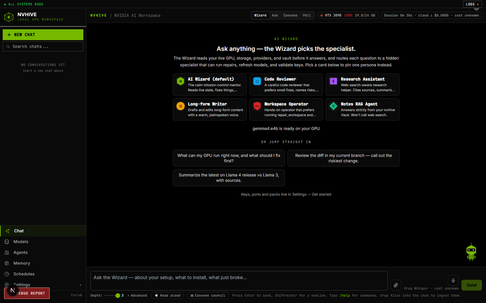

<div align="center">

# nvHive

**Turn an NVIDIA machine you rent or own into a working AI lab with one command.**

No root. No Docker. Nothing lost on reconnect.

[](https://pypi.org/project/nvhive/)
[](LICENSE)
[](https://github.com/thatcooperguy/nvHive/actions/workflows/ci.yml)

</div>

```bash
curl -sSL https://raw.githubusercontent.com/thatcooperguy/nvHive/main/install.sh | bash
```

On a Linux desktop session use [`start-linux.sh`](docs/GETTING_STARTED.md#desktop-session-click-first); Windows and macOS are best-effort ([Getting Started](docs/GETTING_STARTED.md)). Already have Python 3.11+? `pip install nvhive` — the published release follows the tags, this repository is ahead of it.

## What happens next

1. The installer picks a home that survives resets (`NVH_HOME`, your persistent volume when it finds one) and shows the ports it will use.
2. It reads your GPU and pulls a local model that fits it. You can skip the pull and use the free cloud tier instead.
3. Ollama, the API and the WebUI each come up and pass a health check — including a real end-to-end answer — before your browser opens.
4. You ask your first question in the chat. No key, no model choice, no setting needed.



## What you get

**A chat that knows the machine.** The Wizard reads live GPU and service state, runs safe repairs, ingests files you drop in (PDFs included), searches the web and cites it. It asks you a question when it needs one, remembers notes into your vault, generates images, and takes dictation from a hold-to-talk mic with Read aloud for its replies. Every answer shows cost and latency. [Web UI →](docs/WEBUI.md)

**Models that fit before you download.** Every model in the catalog carries a fits-your-GPU verdict and its size. One click installs with live progress, or `nvh models pull <tag>`. [Models →](docs/MODELS.md)

**Memory that survives.** Conversations, notes and files live server-side under `NVH_HOME`; pin a thread and it is waiting after a reconnect; `nvh snapshot save` / `restore` moves everything to a new machine. [Configuration →](docs/CONFIGURATION.md)

**Automations.** Scheduled prompts with their own page, an agent library grouped by category, and council mode that runs one question through several models and synthesises the answers (`nvh convene "…"`). [Commands →](docs/COMMANDS.md)

**Doors for builders.** OpenAI- and Anthropic-compatible paths on the same port, an MCP server and client, and `nvh launch <tool>` to point Claude Code, Codex, opencode, Cursor or Continue at it. [Integrations →](docs/INTEGRATIONS.md) · [Providers →](docs/PROVIDERS.md)

## Who it is for

Rented NVIDIA GPU desktops (RunPod, Lambda, Vast and the like) and NVIDIA's own DGX Spark. On a Spark the Wizard can run NVIDIA's install playbooks as approved, audited plans: every `sudo` command is shown on a red card before anything runs, and nvHive never sees your password. The playbooks come from the upstream READMEs and have not yet been exercised by maintainers on Spark hardware. RTX Spark (Windows on Arm) installs but is unverified. [Spark →](docs/GETTING_STARTED.md#spark-playbooks)

## Requirements

- Linux x86_64 or arm64; single-file binaries for Linux, macOS arm64 and Windows x86_64 ship with each [release](https://github.com/thatcooperguy/nvHive/releases/latest)
- No root and no Docker — everything installs to paths you own
- GPU optional — without one you get a small local model plus the free cloud tiers
- About two gigabytes of disk for the smallest local model; the installer checks free space first

## If something breaks

Press **Debug Report** in the dashboard: it writes a redacted report you can paste into an issue. From a terminal:

```bash
nvh services          # per-service health table
nvh status --deep     # full diagnostic
```

Logs live under `$NVH_HOME/logs/`.

## Docs

Use it: [Getting Started](docs/GETTING_STARTED.md) · [Web UI](docs/WEBUI.md) · [Models](docs/MODELS.md) · [Providers](docs/PROVIDERS.md) · [Commands](docs/COMMANDS.md) · [Configuration](docs/CONFIGURATION.md) · [Mascot](docs/MASCOT.md)
Build on it: [Integrations](docs/INTEGRATIONS.md) · [Architecture](docs/ARCHITECTURE.md) · [Testing](docs/TESTING.md) · [Contributing](CONTRIBUTING.md)
Where it is going: [Roadmap](docs/ROADMAP.md) · [Maintainers](docs/MAINTAINERS.md)

## Trust

Cloud providers receive the queries you route to them under their own privacy policies; `nvh ask --local` keeps inference on the machine. AI output can be wrong — review what an agent changes before you ship it. The trust boundary, loopback defaults, the privileged tier and how to report a vulnerability are in [SECURITY](SECURITY.md).

**PolyForm Noncommercial 1.0.0** — use, modify and share nvHive for any noncommercial purpose; selling it or using it commercially is not permitted. See [LICENSE](LICENSE) and [NOTICE](NOTICE.md); versions 0.40.0 and earlier remain MIT. The license grants no rights to the nvHive name or logos; forks use their own names ([TRADEMARKS](TRADEMARKS.md)).
