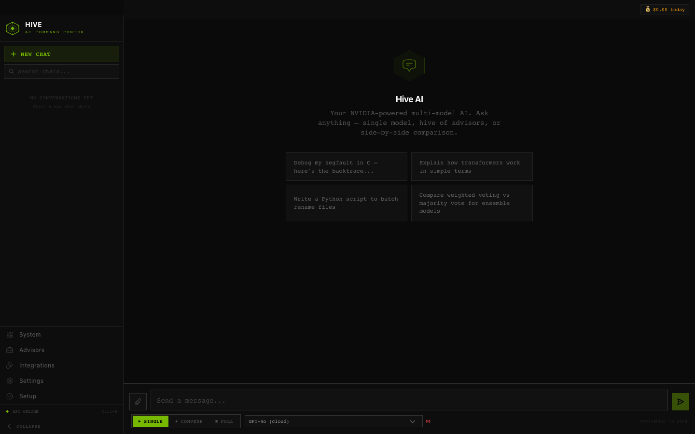
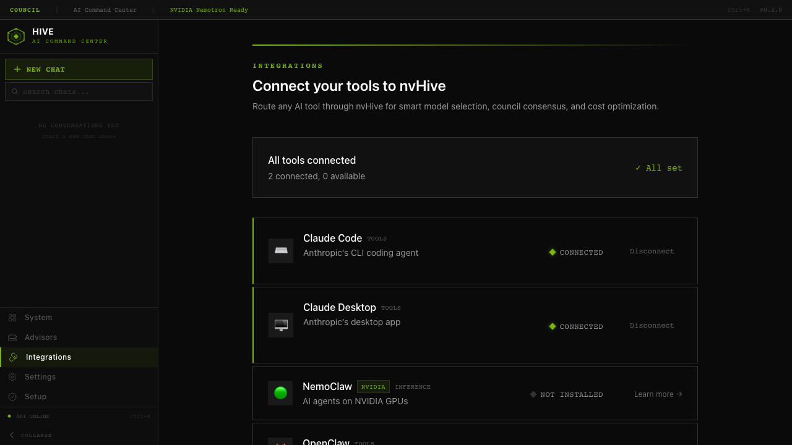
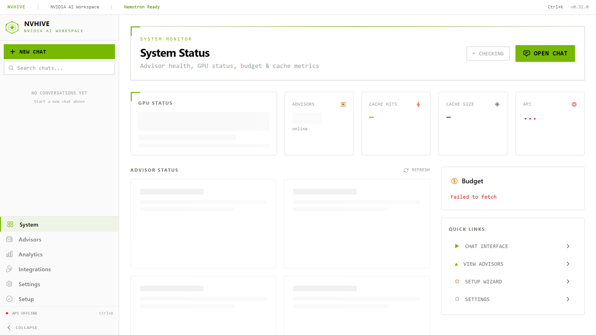
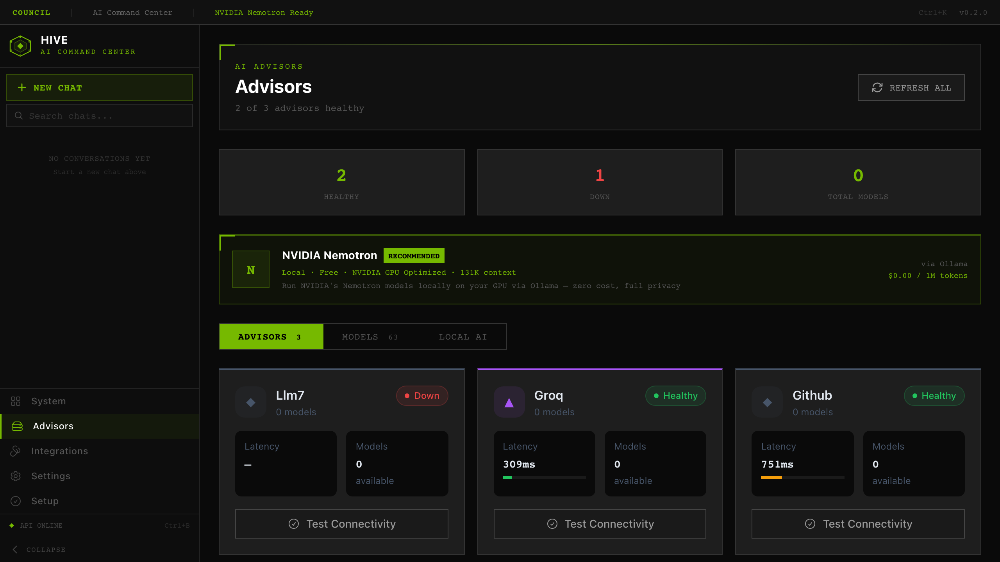
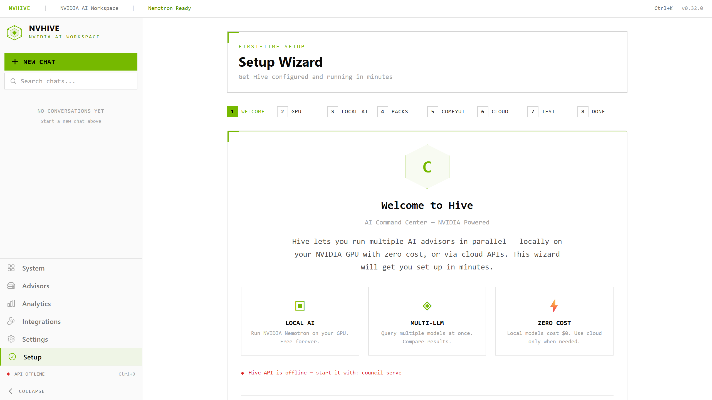
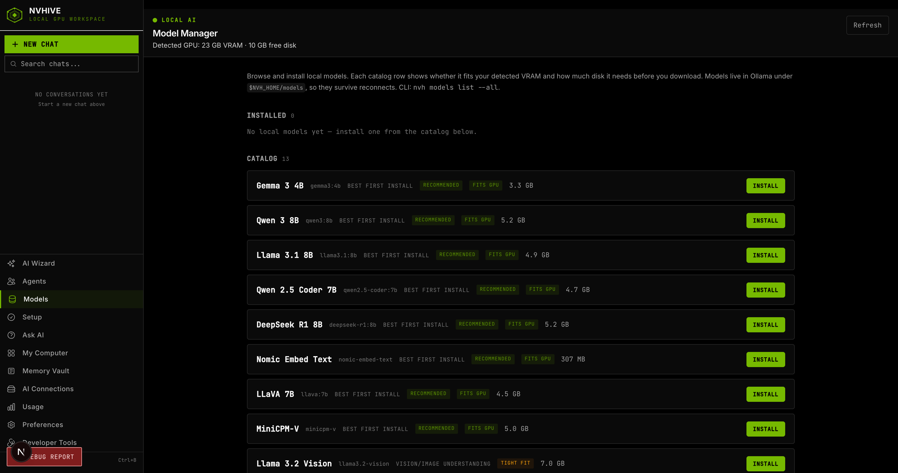

# Web UI

The dashboard is a Next.js app served on `http://localhost:3000` that talks to
the API server on `:8000`. Launch it with:

```bash
nvh webui                  # installs Node deps on first run, starts the API if needed
nvh services start --open  # verified bring-up (Ollama → API → WebUI → smoke test)
```

First launch installs dependencies and builds the WebUI under `NVH_HOME`
(`$NVH_HOME/webui`); later launches run the production server. pip and binary
installs fetch the WebUI source with `git`, or a GitHub source archive when
`git` is absent — the installed release tag first, `main` only as a fallback
(`NVH_WEB_REF` overrides). If port 3000 is taken the API allows the fallback
ports (3001, 3002, 8080) automatically, on `localhost`, `127.0.0.1`,
`nvhive` and loopback IPv6.

## Pages

| Sidebar | Route | What it does |
|---|---|---|
| New Chat | `/` | Prompts in single, council or compare mode with streaming. Council mode has an **Advanced** drawer for cabinet, member count, strategy, synthesis provider and per-provider weights |
| Chat | `/wizard` | Tool-using assistant grounded in live workspace state: refreshes models, runs safe repairs, ingests dropped files (PDF included), searches the web, cites sources, shows cost and latency per reply. By default the concierge picks a hidden specialist from the Agent Library for each turn and the reply credits it; pin one under **Advanced**. Drop, paste or attach images and the Wizard can look at them (the per-message limit is in [CONFIGURATION.md](CONFIGURATION.md#code-and-images-from-the-wizard-chat)). A tool with side effects waits on a confirm card (**Run** / **Skip**); a privileged, sudo-class tool waits on a red approval card that lists the exact commands, and `NVH_ALLOW_PRIVILEGED=0` switches those off. Since 0.46 the Wizard can also ask you a question: a **question card** shows the question, up to six choice chips and a free-text box (unless the Wizard disallowed one) with **Answer** / **Skip** — your answer is your next message (the request history also carries a `tool_results` line naming the question, so the Wizard knows which one was answered; Skip records "skipped by the user; not answered"; nothing is posted to the tool-execute route), and calls the Wizard held behind the question appear as muted `not run: <tool> — held until you answer the question above` lines. It can save a note to your vault (`remember`: the card shows the note before it is written and, once saved, links **Open in vault** to `/vault?id=<id>`; a save the vault refused is shown as a failure) and generate an image (`generate_image`: the card shows a `plan:` line — the server's backend and cost verdict — above **Run** / **Skip**, and Run echoes the card's arguments exactly as received; afterwards the image renders inside the card, fetched with the API key headers, with backend · model · size, the three-state cost pill and the path it was saved to). The API's rules for the three cards are in [CONFIGURATION.md](CONFIGURATION.md#questions-memories-and-images-from-the-wizard-chat). `/wizard?starter=<text>` (or `?issue=<id>`) sends that starter as the first turn. **Convene council** hands the draft to the chat page. Since 0.46 the composer also has a **hold-to-talk mic** beside the attach button (hold the button, or hold Space while the empty box is focused; release to stop): the recording goes to `POST /v1/voice/transcribe` and the transcript is **inserted into the text box, never sent** — a privileged request still has to be read and clicked. The status line under the mic names the path and its cost (`$0, on this device` for local faster-whisper, `Groq Whisper · cost unknown` for Groq) and offers **Download model (~480 MB)** when `nvhive[voice]` is installed but the weights are not (an explicit `voice-model-download` job, watched like an install job); with neither path the mic is disabled with the install hint (`pip install 'nvhive[voice]'` or a Groq key), and without https or localhost it is hidden behind `voice needs https or localhost`; recordings cap at 60 s and are never stored. A **Read aloud** toggle in the composer footer speaks each finished answer with the browser's own `speechSynthesis` — offline, nothing leaves the device, Markdown flattened and fenced code read as `code omitted`; the preference is the browser-local key `nvh.voice.readAloud` ([CONFIGURATION.md](CONFIGURATION.md#voice-from-the-wizard-chat)) |
| Agents | `/agents` | The Agent Library — profiles grouped by category, each mappable to a local or cloud model; copy one into `$NVH_HOME/agent-profiles/` to customise. **Create Agent** can generate a portrait through the NVIDIA image API or a local ComfyUI; when neither is configured the modal says so (naming the backend the API tried and its plan) and offers an upload instead. Each profile's `starter` prompt and the built-ins' `background` / `accent` colours arrive with `GET /v1/wizard/profiles` (`POST` accepts `starter`) and are typed in `web/lib/api.ts`; the page does not draw on them yet |
| Models | `/models` | The Model Manager: installed models, fit-ranked catalog, one-click install with live progress ([MODELS.md](MODELS.md)) |
| Settings → Get started | `/setup` | Onboarding: storage check, GPU detection, local AI, free providers, ComfyUI and studio packs as resumable background jobs; **Advanced Details** exposes diagnostics and **Copy Error Report**; the job list shows install jobs only — scheduled runs are filtered out (`exclude_kind=schedule-run`), so an hourly schedule never pushes an install job out of the window; a `voice-model-download` job (the Wizard mic's **Download model** button, or `nvh voice --download`) is install-like and does appear |
| Settings → This computer | `/system` | GPU, storage, runtime, cache and budget status with recommendations; the Budget widget is cloud-model spend against the `config.yaml` limits (it meters no desktop time) and says when the figures are unavailable instead of showing a zero ledger |
| Memory | `/vault` | Markdown notes under `$NVH_HOME/vault`, queryable from the Wizard through RAG. The page lists the vault's notes newest first (`GET /v1/vault/notes`) with folder chips from the server's directory roster, tag chips from the listed notes, a title/tag search box and a **Memory** toggle that keeps records only (`nvh-memory/1` and `legacy`; the seeded `doc` notes hidden; `/vault?memory=1` opens with it on); a row expands to read the body and path; **Forget** confirms, then removes the file and its search index entry (`DELETE /v1/vault/notes/{id}`; the page says when the index entry could not be dropped); `/vault?id=<id>` — the link a `remember` card and the save form hand out — scrolls to that note and rings it for a few seconds, fetching it on its own when it is outside the loaded page and clearing any filter that hides it (the Memory toggle, a chip, the search box). The save form's folder list comes from the same roster (no hand-typed list), tags start empty and saves are stamped `Source: web`, as is the Wizard chat's `/save` command (folder `Wizard Memory`, tags `wizard`, `chat`); a **Memory** stat card counts the records. Process home only; `nvh vault list` / `nvh vault forget <id>` are the CLI twins ([CONFIGURATION.md](CONFIGURATION.md#memory-records-nvh-memory1)) |
| Settings → Connections | `/providers` | Provider cards: add a key, **Test Connection**, health and model listings |
| Settings → Usage | `/analytics` | Spend, tokens and latency per provider and per agent |
| Settings → Preferences | `/settings` | Theme, response cache, browser data (**Clear browser data** also drops the Wizard's Read-aloud preference, `nvh.voice.readAloud`), and a read-only **Costs** card showing the hourly desktop rate (`budget.hourly_rate_usd`, or `not set`) with the command that sets it, `nvh config set budget.hourly_rate_usd 2.10` — there is no write route; on owned hardware the card notes that the rate only feeds the session pill's desktop term. Model defaults and budgets live in `config.yaml` (`nvh config`) |
| Settings → Developer tools | `/integrations` | Detect and connect Claude Code, Cursor, OpenClaw, NemoClaw; attach external MCP servers and refresh their tools. The manual-setup snippets include **Any OpenAI-compatible client (standard paths)**: `OPENAI_BASE_URL=http://127.0.0.1:8000/v1` with your `HIVE_API_KEY` (any non-empty string in open mode), and for Messages-API SDKs `ANTHROPIC_BASE_URL=http://127.0.0.1:8000/v1/anthropic` / `ANTHROPIC_AUTH_TOKEN`, and the one-liner `nvh launch <tool> --print` (`claude`, `codex`, `opencode`, `continue`, `cursor`), which renders the same variables or the tool's config snippet from the CLI — `nvh launch <tool>` without `--print` first checks that the API is up and safe to hand over (not open-mode off loopback, not keyed without a `HIVE_API_KEY` here), then launches `claude` with nvHive's MCP server registered or, for the four snippet targets, prints the snippet and starts nothing; a target of kind `env` would get the variables in its environment, and none ships yet ([INTEGRATIONS.md](INTEGRATIONS.md#nvh-launch)) |
| Schedules | `/schedules` | Scheduled prompts the API server runs while it is up. The page lists every schedule with its name (or the prompt's head), interval, mode, profile, next run (`due now` / `in 42m` / `paused`), last status (`ran`, `needs your approval`, `skipped (budget)`, `error: …`, `never ran`) and a three-state last-cost pill that shows nothing for a schedule that never ran; per row **Enable** / **Disable**, **Run now** (while a run is still in flight the server's reply names the running job inline), **Runs** (a drawer that tails a run started here live and lists the recorded runs — status, started, cost, the answer's first lines and `deferred: <tools>` when the model asked for something outside the roster; if the page loses the API while tailing, the panel reads `lost contact` in amber with a **Reconnect** button — the run itself keeps going on the server), **Open thread** (`/wizard?conversation=<id>`, the one conversation every run appends to) and **Delete** with an inline confirm. The add form takes a prompt, an interval in `30m` / `1h` / `1d` syntax (validated in the browser before the request), a name, mode `ask` or `convene` only — `do` is CLI-only (`nvh schedule start`) — and a profile from `/v1/wizard/profiles`. A runner line says who is running schedules (the API server, `nvh schedule start`, or nobody, with the two commands to start one), how often it polls, that it keeps the last twenty runs per schedule, and lists the read-only tool roster an unattended turn may call; the list refreshes every 30 s ([CONFIGURATION.md](CONFIGURATION.md#schedule-records-nvh-schedules2)) |

The sidebar shows five destinations — Chat, Models, Agents, Memory, Schedules —
and a **Settings** group holding the six operator pages above (it opens itself
while one of them is active). Every route is unchanged, and the command palette
(`Ctrl+K`) lists each page under its new name and, for one release, its old
one. The `/query` and `/council` pages were removed in 0.42; their features are
the chat page's single and council modes, and their redirects retire with the
`/wizard` redirect that follows the shell merge.

## Chat history

Past conversations live in the sidebar on every page, grouped by date
(Pinned / Today / Yesterday / Previous 7 Days / Older) with search, inline
rename, and a right-click menu (Pin, Rename, Export as Markdown, Delete).

- **One store** — every chat surface persists to the API server (SQLite at
  `$NVH_HOME/state/nvhive.db`) through `/v1/conversations`; nothing is kept
  in the browser. A reload or a reconnect to the same workspace picks any
  thread back up.
- **Resume anywhere** — a conversation reopens on the surface that produced
  it: Wizard chats on `/wizard`, chat/council/compare threads on `/?c=<id>`.
- **Pin** (right-click, or `/pin` in Wizard chat) keeps a thread at the top
  and surfaces it after a reconnect.
- **Search** — the sidebar box queries `GET /v1/conversations/search?q=`
  (full message content with a snippet per hit) and matches titles instantly;
  `Ctrl+K` → "Search Conversations" focuses it.
- **Upgrading from 0.41** — chats older builds kept in localStorage are
  imported into the server store once, on the first page load after the
  upgrade, then the local copy is removed.

## Design

- NVIDIA-inspired dark theme with green (`#76B900`) accents and diamond status
  indicators
- Command palette (`Ctrl+K`); shortcuts `Ctrl+N` new chat, `Ctrl+B` sidebar,
  `Ctrl+/` help
- Streaming over SSE and WebSocket; responsive down to phone width
- Session cost pill (0.46): the shared top bar on every page except `/setup` (and the chat page's own bar on `/`) shows `Session <age>` plus terms joined by ` · `. On a **rented desktop** it reads `Session 4h 12m · desktop ≈ $3.37 · cloud $0.42`: the desktop term is `budget.hourly_rate_usd` × the time since *this tab* opened (a new tab starts at zero — it is not the rental's total), or `set your hourly rate` when none is configured; the cloud term is every cloud-model call on this machine since the tab opened (CLI, other tabs, proxy clients and scheduled runs count), `cloud ≥ $0.42 · cost unknown` when a counted model has no catalog price, or `local only` only when every counted model ran locally (a tab in which nothing has run yet reads `cloud $0.0000`, not `local only`). On an **owned device** there is no desktop term unless a rate is configured (the rate always wins) and no electricity estimate. When device detection is **inconclusive** the pill uses the owned wording and its title says so and names the setting. It turns amber only after fifteen minutes when cloud spend per hour exceeds the rate (never for a rate of exactly 0, which shows the desktop term and nothing to compare against); it reads `spend unavailable` when the server could not read the ledger and falls back to the plain age when the API is unreachable or predates the session ledger. Behind it: `GET /v1/budget/status?since=<when the tab opened>` ([CONFIGURATION.md](CONFIGURATION.md#schema-defaults))
- Mascot: a sprite in the bottom-right corner mirrors what the Wizard is doing
  (thinking, running a tool, waiting for your approval, done, error); click it
  to ask the Wizard or hide it. States, manifest and how to swap the art:
  [MASCOT.md](MASCOT.md)

## Screenshots

| Chat | Integrations |
|:-:|:-:|
|  |  |

| System | Advisors |
|:-:|:-:|
|  |  |

| Setup wizard | Model Manager |
|:-:|:-:|
|  |  |

## Developing the UI

```bash
nvh serve --port 8000          # terminal 1: the API
cd web && npm install && npm run dev   # terminal 2: dev server on :3000
```

`NEXT_PUBLIC_API_URL` (default `http://localhost:8000`) tells the browser
where the API is. `nvh webui --dev` runs the same dev server from the
installed copy; `nvh webui --clean` wipes `node_modules` and `.next` when the
bundled build drifts from the backend. CI type-checks (`npx tsc --noEmit`),
runs the pure-helper tests (`npm test` = `node --test lib/*.test.mjs`: `cost`,
`privileged`, `mascot`, `apiShapes`, `vaultNotes`, `sessionCost`, `schedules`,
`attachments`, `cabinets`, `gpu`, `voice` — Node imports the `.ts` helpers directly, so
a helper under test stays free of React, Next, the `@/` alias and runtime
imports of other `.ts` modules), lints and builds the app on every push; the
API's `ALLOWED_ORIGINS` must keep covering the defaults above.

The Wizard chat is `web/components/chat/WizardThread.tsx` (state, stream,
card handlers, mascot feed) with its view components beside it —
`MessageBlock`, `ToolCard`, `ServerToolTrace`, `SourcesFooter`,
`DeferredToolNotes`, `EmptyState` — and the `Message` model in
`chat/types.ts`; `/wizard` mounts `<WizardThread conversationParam="conversation" />`.
The composer's mic is `web/components/VoiceButton.tsx` (MediaRecorder
hold-to-talk, the **Download model** button, the mascot's "Listening…" tip)
and the Read-aloud switch is `web/components/ReadAloudToggle.tsx`
(`useReadAloud` over `speechSynthesis`), both on the pure rules in
`web/lib/voice.ts` (`voicePlan`, `pickRecorderMime`, `canUseMicrophone`,
`transcriptInsertion`, `stripMarkdownForSpeech`; `lib/voice.test.mjs`) and the
`getVoiceStatus` / `transcribeAudio` / `startVoiceDownload` calls in
`web/lib/api.ts` — `transcribeAudio` is a hand-rolled multipart POST, because
`apiFetch` always sends a JSON content type.
The session pill is `web/components/SessionCostPill.tsx` (rules in
`web/lib/sessionCost.ts`; `SessionAgePill.tsx` re-exports it for the layout).
A handful of Python guards read these files as contracts —
`tests/test_web_surfaces.py`, `tests/test_web_mascot_refusal.py`,
`tests/test_web_wizard_refusal_status.py` and the web pins in
`tests/test_chat_history.py` ([TESTING.md](TESTING.md)) — so a rename or a
moved literal updates the test with it.

Back to [README](../README.md)
